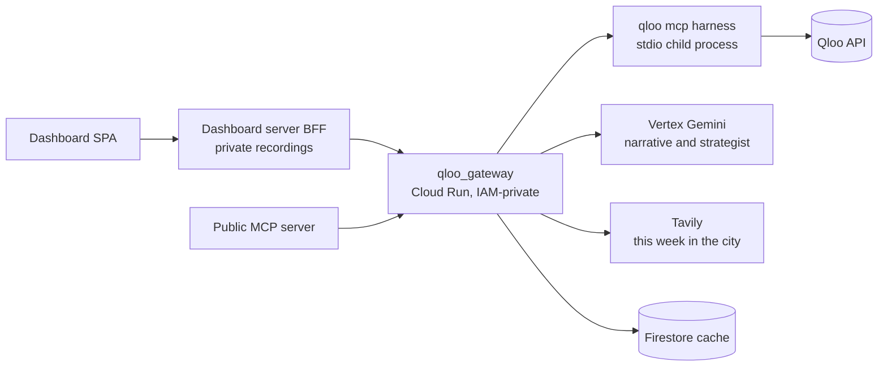

# Tour Intelligence × Qloo

[](https://github.com/prats-2311/tour-intelligence-qloo/actions/workflows/test.yml)

**Route with anything. Win every city with this.**

For each city on a tour, Tour Intelligence shows the brands, venues and support acts the artist's fans rank far above the city as a whole. In Los Angeles, Mac DeMarco's fans rank Stüssy #1; it isn't in LA's overall top 20. That gap is the sponsor pitch. It comes from Qloo's taste graph, it is checked against the city's own baseline, and every written claim is verified against the Qloo results it cites (claims that fail are struck).

Qloo ranked the real tour's pick above a popularity baseline 17–1 (4 ties, p<0.001), and the claim checker caught 10 of 10 planted false claims. Where an LLM did better (city ranking, Test A), we say so under Limits.

Who pays and why: promoters and agencies pay per tour; the return comes from sponsor deals and a better-sold room. We state no revenue, customer or price numbers because we have none.

## Links

- Live app: <https://tour-intel-qloo.web.app> (it opens on a recorded example, so there is nothing to type first)
- Proof page: <https://tour-intel-qloo.web.app/proof>
- Public MCP server (rate-limited demo, no auth): <https://tour-intel-mcp-public-602700957663.us-central1.run.app/mcp>
- Licence: [MIT](LICENSE)
- Proof protocol, with its 6 dated amendments: [docs/qloo/proof-v3-protocol.md](docs/qloo/proof-v3-protocol.md)

## The problem

Sponsorship is the highest-margin business in live music: Live Nation's sponsorship and advertising arm made [$1.3B in 2025 at a 64% margin](https://news.livenationentertainment.com/news/live-nation-entertainment-full-year-and-fourth-quarter-2025-results), and over 70% of 2026 commitments were already booked by February. Market choice still runs on instinct ("[their gut is a combination of hundreds of internalized pieces of data](https://www.waterandmusic.com/how-booking-agents-use-and-dont-use-data)", a Paradigm agent told Water & Music in 2021). Soft markets are costly: [one 2025 tour was cancelled](https://www.complex.com/music/a/alex-ocho/bobby-shmurda-addresses-tour-canceled-booking-agent-claims-low-ticket-sales) at about 10 tickets per city, by its booking agent's account, and Hypebot [reported](https://www.hypebot.com/what-is-blue-dot-fever-the-rising-tide-of-tour-cancellations-in-2026.md) at least 10 major artists postponing or cancelling dates in 2026. Top-100 tour [tickets fell 3.7% to 67.3M in 2025](https://news.pollstar.com/2025/12/12/year-end-business-analysis-a-return-to-earth-2025-grosses-ticket-sales-drop-averages-increase-beyonce-oasis-coldplay-have-top-tours-venues-stadiums-rock/) (Pollstar). Merch adds about [$10.29 per head](https://www.atvenu.com/post/an-updated-look-at-artist-merch-trends) (atVenu). These figures describe the industry, not this tool's results.

## The 2-minute judge path

1. **Markets** (opens on the example): fan heat per city, with a "Try a routing" box to paste your own cities. 
2. **Decide:** winnability per city, and the "where fan heat and winnability disagree" section, described as "worth a second look" rather than a ranking claim.  Compare with the same cities as a generic LLM ranks them, without Qloo: 
3. **Playbook:** open a city for sponsors (with lift versus the city), local guests, venues, support acts, verified claims and verdict clocks. 
4. **Tour Book:** the printable document with a chapter per city. 
5. **Ask about this tour:** a recorded Q&A in which the strategist answers with its work log visible. Then open `/proof`. 

<!-- Screenshot list (one place to fix names): 01-landing, 02-board-winnability, 03-board-without-qloo, 04-playbook-*, 05-tour-book-cover, 06-proof; each in -desktop.png and -mobile.png under docs/screens/ -->

## How it uses Qloo

Every Qloo call goes through one service, [`qloo_gateway`](cloud_run/qloo_gateway), which holds a single `qloo mcp` child process (the Qloo harness, `@qloo/qloo-harness`). Ten harness tools are allowlisted ([ADR 0001](docs/adr/0001-qloo-through-harness-gateway.md)).

| Harness tool | Product job |
|---|---|
| `qloo_describe` | Resolve an artist or city act to a Qloo entity; read its popularity (support acts must be smaller than the headliner) |
| `qloo_where_popular` | Heat points per city: fan heat, and the location check that every city sits on its own heat points |
| `qloo_audience_demographics` | Who the fans are in each city (over/under-index versus average) |
| `qloo_entity_tags` | Taste tags that drive sponsor fit and local hooks |
| `qloo_trends` | Trend window for the artist in the city (7-day cache) |
| `qloo_recommend` | Sponsor brands, real music venues, local acts, film and TV hooks |
| `qloo_rank` | Rank a fixed candidate list by taste fit (venues, local guests, sponsor candidates) |
| `qloo_compare_audiences` | Shared taste between the headliner and a support act or local guest |
| `qloo_find_tags` | Used once, offline, to fix the 4 venue-category tag ids; not called at runtime |
| `qloo_capabilities` | Gateway health check (is the harness connected and ready); plumbing, not a product screen |

A redacted request and result, shape only (the venue call in a city):

```jsonc
// request to qloo_recommend
{ "target_type": "place", "signals": ["<artist entity id>"], "filter_location": "<City, CC>",
  "include_tags": ["<4 venue-category tag ids>"], "include_tags_operator": "union", "limit": 20 }
// result (compacted by the harness)
{ "status": "ok", "entities": [ { "id": "<entity id>", "name": "<venue>", "affinity": 0.xx, "popularity": 0.xx } ] }
```

## How scores work

Scores are deterministic code, never LLM output; missing data gives `insufficient_data`.

- **Winnability = 0.5 × fan heat + 0.5 × activation.** Activation combines sponsor fit, local hooks, venue fit and fan concentration.
- **Calibration `calibrated-2026-10-17`.** Raw affinities saturated near 0.9, so a fixed cut decided cities by noise (activation range 51.5–96.8, IQR 2.67 on 32 recorded cities); after rescaling from per-component floors the range is 0.0–52.0, IQR 24.09. Details in [docs/qloo/calibration.md](docs/qloo/calibration.md). A re-run on 2026-10-24 failed its pre-set gate, so the 2026-10-17 calibration was kept.
- **Location check.** Qloo resolved "Ciudad Juarez, MX" to Mexico City (all 20 heat points about 1,555 km median away), so every city is now checked against its own heat points and flagged if they sit elsewhere ([docs/qloo/api-notes.md](docs/qloo/api-notes.md)).
- **Major markets** with floored fan heat are capped at Consider.
- **Sponsor lift is rank based.** Qloo rescales `affinity` within each response, so an artist response and a city-baseline response are on different scales (an affinity difference showed every sponsor as -2 to -5 "vs city"). Lift is how many places higher fans rank a brand than the city does.
- A close-call flag marks cities whose verdict changes within ±2 points.

## Proof, honestly

Everything below is from [Proof v3](docs/qloo/proof-v3-protocol.md): a protocol committed before any Qloo or Gemini call, with 6 amendments, each committed before the call it affected. We publish whatever came out, including losses. The full tables are at [/proof](https://tour-intel-qloo.web.app/proof). Raw results stay private (Qloo's data policy).

- **Test B, fixed candidates, 22 of 27 reviewed cases** ([protocol](docs/qloo/proof-v3-protocol.md)): Qloo rank beat popularity (p<0.001): mean reciprocal rank 0.47 vs 0.13, 17 wins, 1 loss, 4 ties over 22 cases. Not significant at this sample size: Qloo rank trails Gemini (0.47 vs 0.57; p=0.118; 4 wins, 11 losses, 7 ties).
- **Claim checker** ([protocol](docs/qloo/proof-v3-protocol.md)): it removed 10 of 10 planted false claims (5 plausible wrong numbers, 4 absent numbers, 1 swapped name).
- **Test C, grounding** ([protocol, Amendments 4–6](docs/qloo/proof-v3-protocol.md)):

<!-- TEST-C: filled after rating -->

### Limits

- **Test A, city ranking, 10 of a planned 12 artists** ([protocol](docs/qloo/proof-v3-protocol.md)): The generic LLM beat winnability (p=0.031): mean R-precision 0.82 vs 0.66, 0 wins, 6 losses, 4 ties over 10 artists. For context: fan heat 0.68, population 0.79, chance 0.62. Winnability versus fan heat is not significant (1 win, 1 loss, 8 ties). We therefore do not claim winnability picks better cities, and that is why the product leads with winning each city rather than choosing them ([ADR 0002](docs/adr/0002-winning-a-city-not-choosing-it.md)).
- **Gemini + Qloo combined** ([Amendment 7](docs/qloo/proof-v3-protocol.md), added on 29 Oct after Tests A and B were published, before any combined number was computed): fusing Qloo's ranking into Gemini's (reciprocal rank fusion, k=60) did not beat Gemini alone. Test B: mean reciprocal rank 0.50 vs 0.57 (4 wins, 10 losses, 8 ties over 22 cases; p=0.180, not significant). Test A: mean R-precision 0.75 vs 0.82 for the LLM alone (0 wins, 4 losses, 6 ties over 10 artists; p=0.125, not significant). Exploratory, small n: on the 4 Test B cases dated after the answering model's training cutoff, fusion scored 0.47 vs Gemini 0.31 (2 wins, 2 losses; p=1.0, no claim); no Test A tour started after the cutoff.

**Limits.** Qloo data is current, not as of the tour date. "Played" means agreement with the routing a tour actually took, not profit. Samples are small. The venue-name proxy stands in for mid-tier. The Test C reviewer saw the showcase playbooks. The earlier 2026-10-17 backtest (the playbook's local-act card against city popularity and a generic LLM, on 27 cases) is still published at `/proof` and did not beat the LLM at naming a famous local guest, which is why that card is now a hybrid in which Gemini proposes and Qloo verifies.

## Architecture



Decisions: [ADR 0001 Qloo through the harness gateway](docs/adr/0001-qloo-through-harness-gateway.md), [ADR 0002 winning a city, not choosing it](docs/adr/0002-winning-a-city-not-choosing-it.md), [ADR 0003 recordings private, synthetic tests](docs/adr/0003-recordings-private-synthetic-tests.md). The design spec is [docs/superpowers/specs/2026-10-16-tour-intelligence-qloo-design.md](docs/superpowers/specs/2026-10-16-tour-intelligence-qloo-design.md).

### Connect an MCP client

```bash
claude mcp add --transport http tour-intel https://tour-intel-mcp-public-602700957663.us-central1.run.app/mcp
```

Five tools: `find_tour_markets`, `get_city_playbook`, `suggest_support_acts`, `rank_venues`, `get_local_moment`. Limit 30 requests per 10 minutes per IP, 2 regions and 3 stops per board, cached results, and a shared daily Qloo budget. Results are affinity signals from aggregate taste data, not ticket forecasts or claims about individuals.

## Run it

Needs Node 22 and a Qloo hackathon key. Environment variable names only (never commit values): `QLOO_API_KEY`, `QLOO_BASE_URL`, `QLOO_TRUSTED_BASE_URL`, `QLOO_GATEWAY_URL`, `TOUR_DATA_API_URL`, `RECORDINGS_DIR`; Google Cloud application-default credentials for Vertex and Firestore.

```bash
npm i -g @qloo/qloo-harness@^0.1.26 && qloo setup --qloo
cd cloud_run/qloo_gateway && npm ci && npm run build && npm test
cd ../../dashboard && npm ci && npm test
./run_tests.sh                       # pytest, dashboard and gateway vitest, graft check
cd dashboard && RECORDINGS_DIR=<dir> npm run server & npm run dev
```

`RECORDINGS_DIR` holds the real recordings; without it, synthetic fixtures stand in and `?sample=1` shows the invented Lumen Vale tour.

## Limitations

- Affinity is a taste signal, not a ticket forecast.
- The hybrid local-act card (Gemini proposes, Qloo verifies) is not covered by the earlier backtests.
- The proof samples are small (10 artists, 22 cases) and the limits above apply.
- The public MCP is a rate-limited demo running on the author's Qloo key.
- WebMCP tools need Chrome with the feature enabled.

## Data policy

No Qloo response data is committed here. Real recordings are served from private storage by the dashboard server; tests use synthetic fixtures; `scripts/check-public-data.sh` guards the public clone. Only artist, city, venue and brand names go to Qloo, never personal data. See [ADR 0003](docs/adr/0003-recordings-private-synthetic-tests.md).

## New versus existing project

Forked from the author's Agentic Cinema (Google Cloud) entry, which supplies the legacy `tour_data_api`, Dialogflow agents and delight-card renderer (see [`archive/`](archive)). The Qloo work began on 2026-10-16: the gateway, scoring, Tour Board, playbooks, Tour Book, strategist, MCP tools, proof and calibration. At the time of writing, 177 commits since that date (`git rev-list --count --since=2026-10-16 HEAD`; `node scripts/readme-numbers.mjs` prints the figures used here).

### What's next (not built)

Next: a saved taste profile for each artist on a manager's roster: their own likes, their no-go brands, and the outcome of every activation. Qloo supplies the taste, the profile supplies the intent, and the results make each tour's plan better than the last.

## Licence

[MIT](LICENSE) © 2026 Prateek Srivastava
