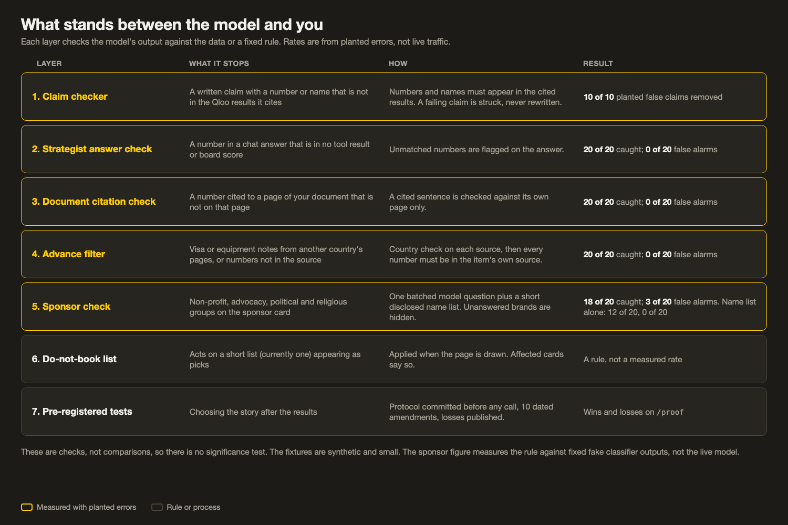
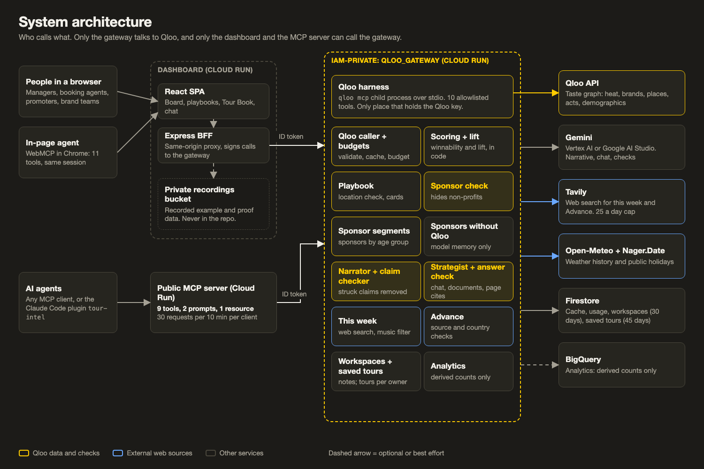
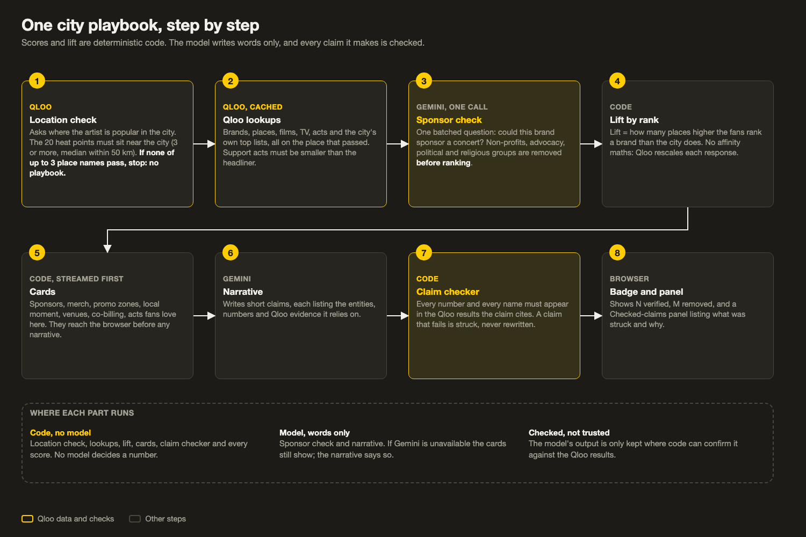
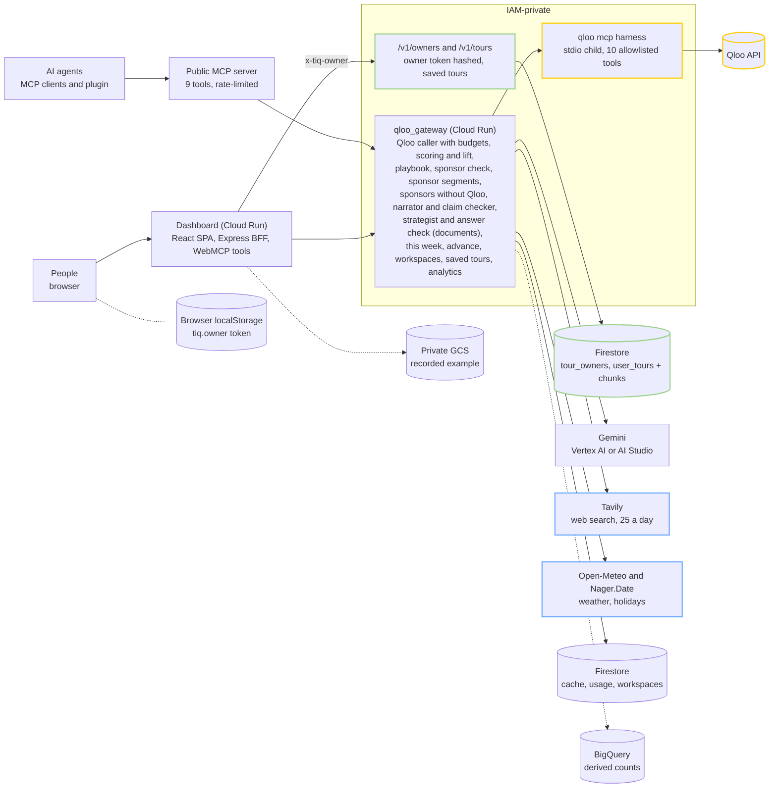
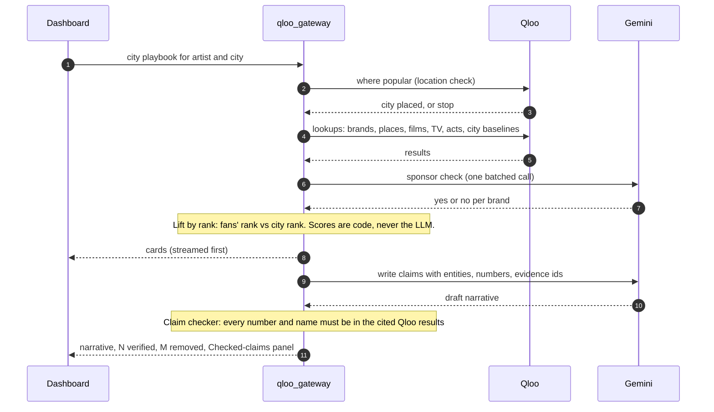
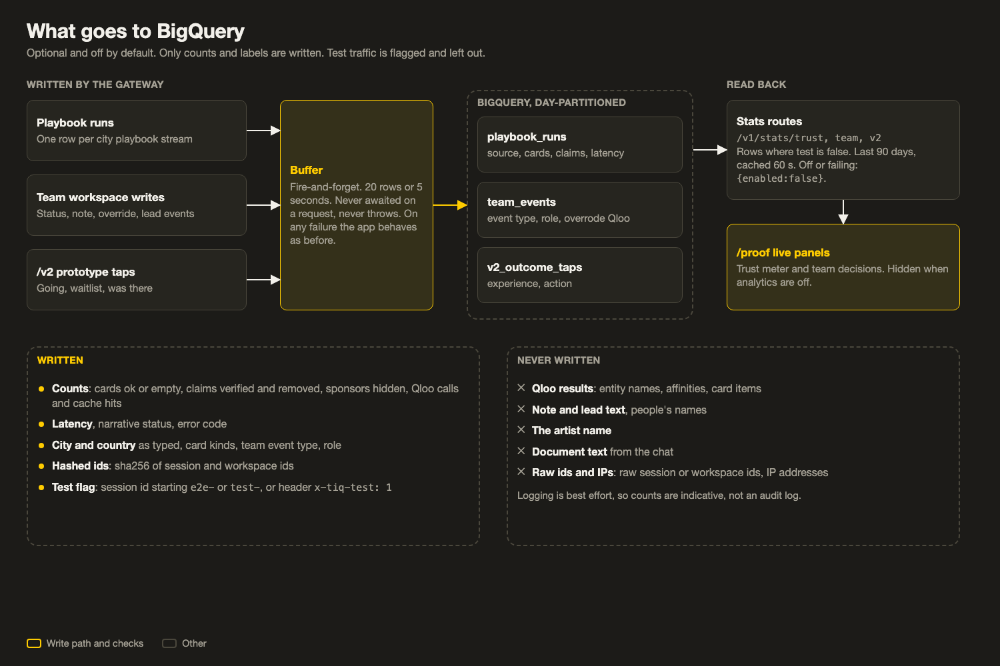
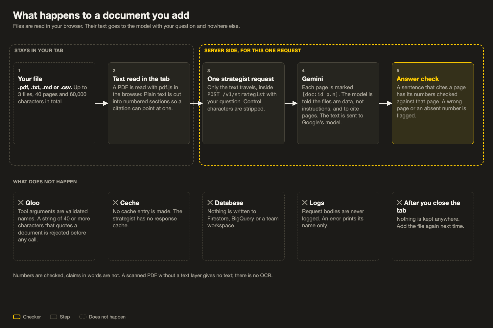

# Tour Intelligence × Qloo

[](https://github.com/prats-2311/tour-intelligence-qloo/actions/workflows/test.yml)

**Route with anything. Win every city with this.**

Sponsor lift by city and by age group, checked against the data, for every stop on a tour.

For each city on a tour, Tour Intelligence shows the brands, venues and support acts the artist's fans rank far above the city as a whole. In Los Angeles, Mac DeMarco's fans rank Stüssy #1; it isn't in LA's overall top 20. That gap is the sponsor pitch. It comes from Qloo's taste graph, it is checked against the city's own baseline, and every written claim is verified against the Qloo results it cites (claims that fail are struck).

Among 10 candidates per case, Qloo put the real tour's pick at mean reciprocal rank 0.47, against 0.29 for a random order and 0.13 for the city's popularity list, which usually didn't contain the pick at all (Qloo ahead in 17 of 22 cases, p<0.001). Gemini alone did better still (0.57; not significant), and the claim checker caught 10 of 10 planted false claims. Where an LLM did better, we say so under Limits.

Who pays and why: promoters and agencies pay per tour; the return comes from sponsor deals and a better-sold room. We state no revenue, customer or price numbers because we have none.

## Links

- Live app: <https://tour-intel-qloo.web.app> (it opens on a recorded example, so there is nothing to type first)
- Proof page: <https://tour-intel-qloo.web.app/proof>
- Public MCP server (rate-limited demo, no auth): <https://tour-intel-mcp-public-602700957663.us-central1.run.app/mcp>
- Licence: [MIT](LICENSE)
- Proof protocol, with its 10 dated amendments: [docs/qloo/proof-v3-protocol.md](docs/qloo/proof-v3-protocol.md)
- Decisions: [ADRs 0001 to 0008](docs/adr)

**Contents:** [Try it in 2 minutes](#try-it-in-2-minutes) · [What it does](#what-it-does) · [How it uses Qloo](#how-it-uses-qloo) · [How scores work](#how-scores-work) · [Proof, honestly](#proof-honestly) · [Architecture](#architecture) · [Connect an AI agent](#connect-an-ai-agent) · [Run it locally](#run-it-locally) · [Tests](#tests) · [Analytics](#analytics) · [Privacy](#privacy) · [Limitations](#limitations)

## The problem

Sponsorship is the highest-margin business in live music: Live Nation's sponsorship and advertising arm made [$1.3B in 2025 at a 64% margin](https://news.livenationentertainment.com/news/live-nation-entertainment-full-year-and-fourth-quarter-2025-results), and over 70% of 2026 commitments were already booked by February. Market choice still runs on instinct ("[their gut is a combination of hundreds of internalized pieces of data](https://www.waterandmusic.com/how-booking-agents-use-and-dont-use-data)", a Paradigm agent told Water & Music in 2021). Soft markets are costly: [one 2025 tour was cancelled](https://www.complex.com/music/a/alex-ocho/bobby-shmurda-addresses-tour-canceled-booking-agent-claims-low-ticket-sales) at about 10 tickets per city, by its booking agent's account, and Hypebot [reported](https://www.hypebot.com/what-is-blue-dot-fever-the-rising-tide-of-tour-cancellations-in-2026.md) at least 10 major artists postponing or cancelling dates in 2026. Top-100 tour [tickets fell 3.7% to 67.3M in 2025](https://news.pollstar.com/2025/12/12/year-end-business-analysis-a-return-to-earth-2025-grosses-ticket-sales-drop-averages-increase-beyonce-oasis-coldplay-have-top-tours-venues-stadiums-rock/) (Pollstar). Merch adds about [$10.29 per head](https://www.atvenu.com/post/an-updated-look-at-artist-merch-trends) (atVenu). These figures describe the industry, not this tool's results.

## Try it in 2 minutes

Open <https://tour-intel-qloo.web.app>. It opens on a recorded example, so there is nothing to type. The landing page also offers "Take the 2-minute tour" (Back, Next, Skip; it never starts on its own, and there are four short tours). To do it by hand:

1. **Landing.** Fan heat per city on the recorded tour. 
2. **Los Angeles playbook, sponsor hook.** Open Los Angeles. The Sponsors card ranks brands by how much higher the fans rank them than the city does, which is the hook above. 
3. **By age group.** On the Sponsors card, pick an age group to see brands that group's fans rank higher.
4. **Pitch sheet.** Open a sponsor's pitch sheet: one page, print-ready.
5. **Claims.** Open a claim badge to see the Checked-claims panel: what was verified against the cited Qloo results, and what was struck.
6. **/proof, "At a glance".** The scoreboard of what Qloo won and what a plain LLM won. 
7. **/agents.** The nine public MCP tools, the plugin and WebMCP, with an example tour report for a fictional artist.

Also worth a look: the board's winnability view  and the same cities as a generic LLM ranks them, without Qloo , and the printable Tour Book .

<!-- Screenshot list (one place to fix names): 01-landing, 02-board-winnability, 03-board-without-qloo, 04-playbook-*, 05-tour-book-cover, 06-proof; each in -desktop.png and -mobile.png under docs/screens/ -->

## What it does

### Plan

- **Tour Board.** Winnability per city, which is 0.5 x fan heat + 0.5 x activation, with a verdict (Play, Hidden goldmine, De-risk, Consider, Skip, or Not enough data). "Try a routing" scores cities you paste. A "Without Qloo" view shows the same cities as a generic LLM ranks them. A "where fan heat and winnability disagree" section is "worth a second look", not a ranking claim.
- **City playbooks.** One per city, built from the artist's fans:
  - **Sponsors** with rank-based lift versus the city, and a **By age group** view that uses Qloo audience demographics and its demographic signal, on age only. Each group shows a signed index such as "+0.91 vs the average audience (not a share)". Groups that include under-21s carry a note to keep alcohol sponsors out.
  - **Pitch sheet** per sponsor: one page that prints.
  - **Compare: the same model without Qloo.** Gemini lists five brands from memory; the card shows where Qloo's own fan and city rankings place them. It shows how far a model's memory strays from these fans' taste, not that Qloo's ranking is right.
  - **Venues** (music venues in the city only), **promo zones**, **co-billing** (support acts smaller than the headliner), **Acts these fans love here** (some may not be local, see Proof) and **Places, films and TV these fans love**.
  - **Advance & risks.** Weather history from Open-Meteo for the dates (labelled not a forecast), public holidays from Nager.Date, and visa and equipment notes from Tavily search plus Gemini. Every web source is checked against the destination country, and every number in a note must appear in its own source.
  - **Checked-claims panel** from any claim badge, and a "How to read these numbers" key.
- **Charts** (`/tours/insights`). An age matrix by city, a fan heat versus activation quadrant with the verdict guide lines, and filters.
- **Saved tours** (`/tours/mine`). When a live board finishes, the tour is saved as a draft automatically; the recorded example is never saved. Search by artist, city or title (accent-insensitive, every word must match), filter Drafts or Final, then Open to replay the saved run with no new Qloo calls for the board, Mark final or draft, or Delete. No sign-in: your browser holds an anonymous owner token, and only that browser can see its tours. Up to 50 tours (60 saves an hour and 40 MB in all per owner), kept 45 days after the last change, and an idle owner expires 90 days after last use. See [ADR 0009](docs/adr/0009-saved-tours-anonymous-owner-tokens.md).
- **Budget** (`/tours/budget`). Your own figures per city and per leg, totals, CSV export. It stays in your browser and nothing is estimated for you.
- **Tour Book.** The printable document with a chapter per city, `.ics` dates, sharing, and your team's decisions.
- **Taste Loop concept** at `/v2`. A fictional artist with real LA data, no predicted numbers, a short tour and "Experiences fans could book". Its RSVP-style buttons are logged as anonymous prototype taps when analytics are on, and stay disabled otherwise.

### Prove

- **/proof.** An "At a glance" scoreboard, each pre-registered test with its losses, the checker catch rates, and (when analytics are on) live panels from real use. See [Proof, honestly](#proof-honestly).
- **Checks in the product.** Claim checker, strategist answer check, document citation check, Advance source and number filter, sponsor check, and a short do-not-book list ([diagram](docs/diagrams/trust-layers.png)).

### Team

- **Strategist chat.** Ask about the tour with its work log visible. On the recorded example you can pick an "Ask live" suggestion or type a question. Add up to 3 private documents (PDF, text, Markdown or CSV) and get answers with page citations that are checked. "Draft a city plan" writes a one-page plan with fixed sections. "Save to team notes" files an answer in the workspace after you confirm.
- **Team workspaces.** Share a link, no sign-in. A workspace holds city statuses, notes on cities and cards, overrides of Qloo's pick (each with a reason), sponsor leads and an activity log, and shows the decisions in the Tour Book. Each visitor of the recorded example gets a private copy with a seeded discussion between fictional teammates.
- **Guided tours.** Four short ones: The essentials, Plan the tour (ends at My tours), Work as a team (offered when workspaces are on), Trust and agents.
- **Shell.** Sidebar with breadcrumbs and tooltips, toasts for saves and shares, a skip link, a not-found page, a favicon and a link preview card. Place rows open a Google Maps search; act rows open a Spotify search.

### Agents

- **Public MCP server and Claude Code plugin.** See [Connect an AI agent](#connect-an-ai-agent).
- **WebMCP.** The dashboard registers 11 tools in Chrome: `get_tour_board`, `get_city_playbook`, `open_city`, `set_comparison_mode`, `build_tour_from_shortlist`, `open_tour_book`, `get_sponsors_by_age`, `get_advance_risks`, `get_team_notes`, `add_team_note`, `set_city_status`.
- **/agents.** Lists the tools, the install lines and an example report.

## How it uses Qloo

Every Qloo call goes through one service, [`qloo_gateway`](cloud_run/qloo_gateway), which holds a single `qloo mcp` child process (the Qloo harness, `@qloo/qloo-harness`). Ten harness tools are allowlisted ([ADR 0001](docs/adr/0001-qloo-through-harness-gateway.md)).

| Harness tool | Product job |
|---|---|
| `qloo_describe` | Resolve an artist or city act to a Qloo entity; read its popularity (support acts must be smaller than the headliner) |
| `qloo_where_popular` | Heat points per city: fan heat, and the location check that every city sits on its own heat points |
| `qloo_audience_demographics` | Who the fans are in each city (over/under-index versus average) |
| `qloo_entity_tags` | Taste tags that drive sponsor fit and local hooks |
| `qloo_trends` | Trend window for the artist in the city (7-day cache) |
| `qloo_recommend` | Sponsor brands, real music venues, local acts, film and TV hooks |
| `qloo_rank` | Rank a fixed candidate list by taste fit (venues, acts fans love, sponsor candidates) |
| `qloo_compare_audiences` | Shared taste between the headliner and a support act or a city act |
| `qloo_find_tags` | Used once, offline, to fix the 4 venue-category tag ids; not called at runtime |
| `qloo_capabilities` | Gateway health check (is the harness connected and ready); plumbing, not a product screen |

A redacted request and result, shape only (the venue call in a city):

```jsonc
// request to qloo_recommend
{ "target_type": "place", "signals": ["<artist entity id>"], "filter_location": "<City, CC>",
  "include_tags": ["<4 venue-category tag ids>"], "include_tags_operator": "union", "limit": 20 }
// result (compacted by the harness)
{ "status": "ok", "entities": [ { "id": "<entity id>", "name": "<venue>", "affinity": 0.xx, "popularity": 0.xx } ] }
```

## How scores work

Scores are deterministic code, never LLM output; missing data gives `insufficient_data`.

- **Winnability = 0.5 × fan heat + 0.5 × activation.** Activation combines sponsor fit, local hooks, venue fit and fan concentration.
- **Calibration `calibrated-2026-10-17`.** Raw affinities saturated near 0.9, so a fixed cut decided cities by noise (activation range 51.5–96.8, IQR 2.67 on 32 recorded cities); after rescaling from per-component floors the range is 0.0–52.0, IQR 24.09. Details in [docs/qloo/calibration.md](docs/qloo/calibration.md). A re-run on 2026-10-24 failed its pre-set gate, so the 2026-10-17 calibration was kept.
- **Location check.** Qloo resolved "Ciudad Juarez, MX" to Mexico City (all 20 heat points about 1,555 km median away), so every city is now checked against its own heat points and flagged if they sit elsewhere ([docs/qloo/api-notes.md](docs/qloo/api-notes.md)).
- **Major markets** with floored fan heat are capped at Consider.
- **Sponsor lift is rank based.** Qloo rescales `affinity` within each response, so an artist response and a city-baseline response are on different scales (an affinity difference showed every sponsor as -2 to -5 "vs city"). Lift is how many places higher fans rank a brand than the city does.
- A close-call flag marks cities whose verdict changes within ±2 points.

## Proof, honestly

Everything below is from [Proof v3](docs/qloo/proof-v3-protocol.md): a protocol committed before any Qloo or Gemini call, with 10 amendments, each committed before the call it affected. We publish whatever came out, including losses. The full tables are at [/proof](https://tour-intel-qloo.web.app/proof). Raw results stay private (Qloo's data policy).

### Scoreboard

| Where Qloo wins | Where a plain LLM wins or nothing separates |
|---|---|
| Test B: beat the city popularity list, 17 wins, 1 loss, 4 ties over 22 cases, p<0.001, mean reciprocal rank 0.47 vs 0.13 | Test A: a generic LLM beat winnability on cities played, R-precision 0.82 vs 0.66, p=0.031 (10 artists) |
| Test B after the model's cutoff (Amendment 9): beat popularity, 0.70 vs 0.10, p=0.016, 7 wins, 0 losses, 1 tie over 8 cases | Test B: Qloo trails Gemini, 0.47 vs 0.57, p=0.118, not significant |
| Claim checker: removed 10 of 10 planted false claims | Amendment 9: Qloo trails Gemini, 0.70 vs 0.88, p=0.625, not significant (1 win, 3 losses, 4 ties; 8 of 18 cases scored, 10 excluded because the real pick could not be resolved in Qloo) |
| | Test C: the LLM-only playbook beat Qloo on names that exist in the city, overall 1.00 vs 0.84, p=0.016; local acts 0.48 vs 1.00 |
| | Fusion (Amendment 7): Qloo ranking fused into Gemini's did not beat Gemini alone |

The cases in Amendment 9 were collected and verified by AI agents, with no human review. Most of Test C was rated by AI agents (see below). The same scoreboard is the first thing on [/proof](https://tour-intel-qloo.web.app/proof) ("At a glance"), computed from the published results.

- **Test B, fixed candidates, 22 of 27 reviewed cases** ([protocol](docs/qloo/proof-v3-protocol.md)): Qloo rank beat popularity (p<0.001): mean reciprocal rank 0.47 vs 0.13, 17 wins, 1 loss, 4 ties over 22 cases. Not significant at this sample size: Qloo rank trails Gemini (0.47 vs 0.57; p=0.118; 4 wins, 11 losses, 7 ties).
- **Test B after the model's cutoff** ([Amendment 9](docs/qloo/proof-v3-protocol.md), cases dated 1 Apr to 29 Oct 2026, fixed before any case was collected): 8 of 18 collected cases were scored. Mean reciprocal rank: Qloo rank 0.70, Gemini 0.88, popularity 0.10; chance level 0.29. Qloo rank beat popularity (p=0.016): 7 wins, 0 losses, 1 tie over 8 cases. Not significant at this sample size: Qloo rank trails Gemini (0.70 vs 0.88; p=0.625; 1 win, 3 losses, 4 ties). 10 cases were excluded because the real pick could not be resolved in Qloo. The cases were collected and verified by AI agents, with no human review, and the sample is small.
- **Claim checker** ([protocol](docs/qloo/proof-v3-protocol.md)): it removed 10 of 10 planted false claims (5 plausible wrong numbers, 4 absent numbers, 1 swapped name).
- **Test C, grounding** ([protocol, Amendments 4–6 and 8](docs/qloo/proof-v3-protocol.md)): this is a loss for Qloo. We asked whether the names each playbook returns exist in the city. Share rated as existing in the city: venues 1.00 (27/27) for Qloo against 1.00 (36/36) for the LLM-only playbook; brands 1.00 (31/31) against 1.00 (36/36); local acts 0.48 (13/27) against 1.00 (27/27); overall 0.84 against 1.00. The LLM-only playbook beat Qloo in 7 cities, Qloo won none and 2 tied (p=0.016). The secondary analysis (each playbook cut to the smaller of the two counts per city and category) reaches the same conclusion. Qloo's local-act names were often real acts that are not from the city, so the playbook card is now called "Acts these fans love here" and carries a warning that some acts may not be local. **Raters (Amendment 8):** 148 of 182 rows were rated by blinded AI agents (Claude Sonnet), with every local-act row and every uncertain row re-checked against a fetched page. The author rated 34 rows and agreed with the agents on 28 (82%); the author adjudicated the 6 disagreements against the fetched evidence. The author had seen the showcase playbooks, so those 34 ratings are not fully blind to prior exposure. Names stay private; only aggregates are published.

**Verified claims, across the product** ([Amendment 10](docs/qloo/proof-v3-protocol.md), written 30 Oct before any of it was run). The claim checker above is one of five checks that stop a wrong number or name reaching the user. Each of the others was given 20 planted errors and 20 clean controls, from fixed, deterministic generators written into the protocol (run offline: no Qloo or Gemini call). These are checks, not comparisons, so there is no significance test.

| Checker | What it guards | Planted errors caught | False alarms on clean controls |
|---|---|---|---|
| Strategist answer check | Numbers in the strategist's answers that appear in no tool result | 20 of 20 | 0 of 20 |
| Document citation check | Numbers cited to a page of your document that do not contain them | 20 of 20 | 0 of 20 |
| Advance source and number filter | Visa and customs notes from another country's pages, or with numbers not in their source | 20 of 20 | 0 of 20 |
| Sponsor check | Non-profits, advocacy, political and religious groups listed as sponsors | 18 of 20 | 3 of 20 |

The planted errors are synthetic and the fixtures small. The sponsor row measures the rule given a fixed fake classifier output (including made-up wrong and missing answers), not the live model; with the classifier unavailable, the name rule alone caught 12 of 20 with 0 of 20 false alarms. The 2 misses are classifier answers that wrongly said "yes"; the 3 false alarms are brands the made-up classifier wrongly said "no" or did not answer for. Counts of automated tests, rule mutation checks and end-to-end specs are on `/proof`.



### Limits

- The popularity baseline is weak by construction: in 18 of 22 cases the real pick wasn't on the city's popularity list, so that arm ranked it last.
- **Test A, city ranking, 10 of a planned 12 artists** ([protocol](docs/qloo/proof-v3-protocol.md)): The generic LLM beat winnability (p=0.031): mean R-precision 0.82 vs 0.66, 0 wins, 6 losses, 4 ties over 10 artists. For context: fan heat 0.68, population 0.79, chance 0.62. Winnability versus fan heat is not significant (1 win, 1 loss, 8 ties). We therefore do not claim winnability picks better cities, and that is why the product leads with winning each city rather than choosing them ([ADR 0002](docs/adr/0002-winning-a-city-not-choosing-it.md)).
- **Gemini + Qloo combined** ([Amendment 7](docs/qloo/proof-v3-protocol.md), added on 29 Oct after Tests A and B were published, before any combined number was computed): fusing Qloo's ranking into Gemini's (reciprocal rank fusion, k=60) did not beat Gemini alone. Test B: mean reciprocal rank 0.50 vs 0.57 (4 wins, 10 losses, 8 ties over 22 cases; p=0.180, not significant). Test A: mean R-precision 0.75 vs 0.82 for the LLM alone (0 wins, 4 losses, 6 ties over 10 artists; p=0.125, not significant). Exploratory, small n: on the 4 Test B cases dated after the answering model's training cutoff, fusion scored 0.47 vs Gemini 0.31 (2 wins, 2 losses; p=1.0, no claim); no Test A tour started after the cutoff.

**Limits.** Qloo data is current, not as of the tour date. "Played" means agreement with the routing a tour actually took, not profit. Samples are small. The venue-name proxy stands in for mid-tier. Test C was rated mostly by AI agents, and the author's 34 ratings follow prior exposure to the showcase playbooks. The earlier 2026-10-17 backtest (the playbook's local-act card against city popularity and a generic LLM, on 27 cases) is still published at `/proof` and did not beat the LLM at naming a famous local guest, which is why that card is now a hybrid in which Gemini proposes and Qloo verifies.

## Architecture



One city playbook, step by step:



<details><summary>Mermaid source</summary>





</details>

Decisions, each with context and consequences:

- [ADR 0001 Qloo through the harness gateway](docs/adr/0001-qloo-through-harness-gateway.md)
- [ADR 0002 winning a city, not choosing it](docs/adr/0002-winning-a-city-not-choosing-it.md)
- [ADR 0003 recordings private, synthetic tests](docs/adr/0003-recordings-private-synthetic-tests.md)
- [ADR 0004 private document context](docs/adr/0004-private-document-context.md)
- [ADR 0005 BigQuery analytics](docs/adr/0005-bigquery-analytics.md)
- [ADR 0006 team workspaces as capability links](docs/adr/0006-workspaces-capability-links.md)
- [ADR 0007 public MCP server and plugin](docs/adr/0007-public-mcp-and-plugin.md)
- [ADR 0008 honest proof](docs/adr/0008-honest-proof.md)
- [ADR 0009 saved tours with gateway-issued anonymous owner tokens](docs/adr/0009-saved-tours-anonymous-owner-tokens.md)

The design spec is [docs/superpowers/specs/2026-10-16-tour-intelligence-qloo-design.md](docs/superpowers/specs/2026-10-16-tour-intelligence-qloo-design.md).

## Connect an AI agent

Claude Code plugin (the MCP server plus a `plan-tour` skill that tells the agent how to present results honestly; no key needed):

```
/plugin marketplace add prats-2311/tour-intelligence-qloo
/plugin install tour-intel@tour-intelligence-qloo
```

Or add the MCP server to any client:

```bash
claude mcp add --transport http tour-intel https://tour-intel-mcp-public-602700957663.us-central1.run.app/mcp
```

| Tool | Use it to |
|---|---|
| `find_tour_markets` | Score and rank touring markets |
| `get_city_playbook` | Compact playbook for one artist in one city |
| `suggest_support_acts` | Co-billing acts with shared taste and local affinity |
| `rank_venues` | Rank up to 10 venues by taste fit |
| `get_local_moment` | Local events, scenes and places that fit the audience |
| `get_sponsors_by_age` | Brands by age group |
| `get_advance_risks` | Typical weather, holidays, visa and equipment notes with sources |
| `get_team_notes` | Read a team workspace from its share link (read-only) |
| `get_tour_report` | Board plus top playbooks in one call |

The server also offers the prompts `plan_tour` and `brief_for_sponsor_meeting` and the resource `tour-intel://about`. All tools are read-only. Limits: 30 requests per 10 minutes per client (`get_tour_report` counts as 3 and takes 1 to 3 minutes on a cold cache), 2 regions and 3 stops per call, cached results, and a shared daily Qloo budget. Results are affinity signals from aggregate taste data, not ticket forecasts or claims about individuals. More in [ADR 0007](docs/adr/0007-public-mcp-and-plugin.md) and [`plugins/tour-intel`](plugins/tour-intel/README.md).

## Run it locally

Needs Node 22 (22.19 or newer) and git. Nothing else: no keys, no Google Cloud account, no Firestore.

```bash
git clone <this repo> && cd <repo>
npm run setup        # npm ci for the gateway and the dashboard
npm run dev:all      # gateway :8080 + dashboard server :8787 + Vite :5173, all in memory
```

Open <http://localhost:5173/?sample=1>. `dev:all` prints one line per optional service that is off and what still works. Ctrl+C stops all three.

The real recorded Mac DeMarco example is private under Qloo's data terms and is not in this repo, so a local run uses the synthetic "Lumen Vale" sample instead (the landing page's "See the example tour" says the recording is unavailable and links to the sample; two 503s on `/api/recordings/*` in the browser console are expected). `/proof` loads the private backtest recording, so locally it shows "Proof results are unavailable right now"; the measured results and the scripts that produce them are in this README and `cloud_run/qloo_gateway`.

### Three levels

1. **No keys (sample mode).** Works: the Lumen Vale sample board, city playbooks, Tour Book, Charts, Budget, team workspaces (in memory), `/v2`, `/agents`, `/proof`. Off: live runs for your own artist, Gemini narration, "this week" and Advance, analytics.
2. **Qloo key (live runs).** Install the harness once, put your key in `.env`, restart `dev:all`: `npm i -g @qloo/qloo-harness@^0.1.26 && qloo setup --qloo`, then `cp .env.example .env` and set `QLOO_API_KEY`. Then "Try your own artist" builds real boards. Without Gemini, narration and local acts fall back to deterministic text. Check `http://127.0.0.1:8080/health`: `connected:true` after the first live call.
3. **Plus Gemini.** Either a Google AI Studio key (`GEMINI_API_KEY`, no Google Cloud needed) or Vertex AI (`GOOGLE_CLOUD_PROJECT` plus `gcloud auth application-default login`). If both are set the AI Studio key wins unless `GEMINI_PROVIDER=vertex`. Optional on top: `TAVILY_API_KEY` for this-week and Advance web lookups; `BQ_DATASET` for BigQuery analytics (needs a Google project and ADC).

### Configuration

Names only; copy [`.env.example`](.env.example) to `.env` (git-ignored; loaded by `dev:all`). Never commit values.

| Variable | Needed for | Without it |
| --- | --- | --- |
| `QLOO_API_KEY` | live Qloo runs | live runs disabled; the sample tour still works |
| `GEMINI_API_KEY` or `GOOGLE_CLOUD_PROJECT` + ADC | narration, local acts, sponsor check, strategist | deterministic fallbacks; those features are off |
| `TAVILY_API_KEY` | this week, Advance & risks | those cards are off |
| `BQ_DATASET` (+ project, ADC) | analytics | off; stats routes answer "disabled" |
| `RECORDINGS_DIR` | the private recorded example | the synthetic Lumen Vale sample |
| `QLOO_GATEWAY_URL` | dashboard server to gateway | set by `dev:all`; a loopback URL sends no Google token |
| `PORT`, `GATEWAY_PORT` | ports | gateway 8080, dashboard server 8787, Vite 5173 |

Other names (`QLOO_BASE_URL`, `QLOO_TRUSTED_BASE_URL`, `QLOO_BIN`, daily ceilings, model names, `QLOO_CACHE_BACKEND`, `QLOO_USAGE_BACKEND`, deployment-only URLs) are documented in `.env.example`. The gateway keeps its cache, usage counts and team workspaces in memory unless `QLOO_*_BACKEND=firestore`, which needs Google ADC.

## Tests

Counts at this commit. The Vitest, pytest and script suites were run on a clean `npm ci`:

| Suite | Command | Result |
|---|---|---|
| Dashboard (Vitest) | `cd dashboard && npm test` | 1,811 tests in 153 files, all passing |
| Gateway (Vitest) | `cd cloud_run/qloo_gateway && npm test` | 1,073 passing, 2 skipped (they need private calibration files), in 73 files |
| Public MCP server (pytest) | `pytest cloud_run/agent_mcp_server/tests` | 107 passing (the archived Agentic Cinema Python tests are not counted) |
| Script guards (node:test) | `npm run test:scripts` | 10 passing |
| End-to-end (Playwright) | `cd dashboard && npm run e2e` | 155 tests in 16 spec files, each run at phone and desktop width (310 runs) |

That is 2,991 automated unit and integration tests across the three product suites, plus 310 end-to-end runs. The end-to-end specs run against the dev server with fixtures (or a deployed site through `E2E_BASE_URL`) and are not part of `./run_tests.sh`. The key rules were mutation-checked: a rule was broken on purpose to see whether a test failed, and the commits named "mutation gaps" record the tests added where none did. The numbers shown on `/proof` are fixed when that page is edited and may lag these.

```bash
npm run test:scripts                                  # dev:all and .env.example guards
cd cloud_run/qloo_gateway && npm test                 # gateway
cd dashboard && npm test && npm run lint              # dashboard
./run_tests.sh                                        # everything, needs a Python .venv (see requirements-dev.txt)
```

Tests never call Qloo or Google Cloud; they use fakes and synthetic fixtures.

## Analytics

Optional and off by default. The gateway writes to BigQuery only when `BQ_DATASET` and the project are set (tables are created once by `cloud_run/qloo_gateway/scripts/bq_setup.sh`). It powers two live panels on `/proof`: the trust meter (claims checked and removed, median latency, sponsors hidden) and team decisions (statuses, overrides of Qloo's pick, notes by role).



- **Written:** counts (cards, claims verified and removed, sponsors hidden, Qloo calls and cache hits), latency, narrative status, the city and country as typed, card kinds, team event types and roles, and sha256 hashes of session and workspace ids.
- **Never written:** Qloo results (names, affinities, items), note or lead text, people's names, the artist name, document text, raw ids or IP addresses.
- **Test traffic is excluded.** Our own e2e runs and smoke checks carry a test flag, and the stats leave those rows out.
- **Fail-safe.** Logging is a best-effort buffer that never blocks a request. If analytics are off or a query fails, the panels do not appear.
- The `/v2` taps are taps on a prototype, not real fans.

Details: [ADR 0005](docs/adr/0005-bigquery-analytics.md).

## Privacy

- **Documents you add to the chat** are read in your browser. Only their text goes, inside the strategist request, to the model (Google's Gemini) with your question. It is never sent to Qloo and never stored, cached or logged. It is gone when you close the tab. The chat says this next to the upload control.



- **The budget** stays in your browser's storage.
- **Saved tours** are stored in Firestore so you can come back on the same browser. What is stored: the tour's summary (artist, regions, cities, title, status), search text built from them, and the finished run (the board you saw, in chunks of at most 700,000 characters; at most 4 million in all). The gateway issues a random owner token on first use (`POST /v1/owners`); your browser keeps it in `localStorage` (`tiq.owner`), sends it as `x-tiq-owner`, and the gateway stores only its sha256. Only the owner can read a tour; anyone else gets a 404. Tours expire 45 days after the last change (to match the 45-day Qloo cache; a Firestore TTL on `expiresAt`), an owner with no activity expires 90 days after last use, and you can delete a tour at any time. Nothing is sent to Qloo to save, search or reopen a tour. Clearing site data loses access to your tours. See [ADR 0009](docs/adr/0009-saved-tours-anonymous-owner-tokens.md).
- **Workspaces** are capability links: anyone with the link can read and write, and there is no sign-in. They expire after 30 days. Do not put anything there you would not give to everyone holding the link. See [ADR 0006](docs/adr/0006-workspaces-capability-links.md).
- **Qloo data policy.** No Qloo response data is committed here. Real recordings are served from private storage by the dashboard server; tests use synthetic fixtures; `scripts/check-public-data.sh` guards the public clone. Only artist, city, venue and brand names go to Qloo, never personal data. See [ADR 0003](docs/adr/0003-recordings-private-synthetic-tests.md).
- **Public MCP.** No sign-in; your IP is hashed to scope the rate limit and budget.

More: [ADR 0004](docs/adr/0004-private-document-context.md).

## Limitations

- Affinity is a taste signal, not a ticket forecast.
- The hybrid local-act card (Gemini proposes, Qloo verifies) was not covered by the earlier backtests; Test C later found it often returns acts that are not from the city.
- The proof samples are small (10 artists, 22 cases) and the limits above apply.
- The public MCP is a rate-limited demo running on the author's Qloo key.
- Workspace links are capability links: anyone with the link can read and write the workspace. Demo workspaces expire after 30 days.
- Workspace rate limits are counted per server instance, not across instances.
- Advance & risks comes from web sources and a model summary. It is checked against those sources, but confirm visas and equipment with the venue or an official source.
- Age segments show over- and under-index, which is noisy, not a share of the audience. Qloo's demographic signal accepts numeric age ranges only, so the groups are fixed bands.
- WebMCP tools need Chrome with the feature enabled.
- A short do-not-book list (currently one act) is applied at display time; affected cards say so. Recorded data and proof results are unchanged.
- Non-profit, advocacy, political and religious organisations are kept off the sponsor card by a model check (one batched Gemini call per playbook: could this brand sponsor a concert? Unanswered ids are hidden) plus a short disclosed name list, because Qloo brand entities carry no tag that identifies them. The card says how many were hidden, or that the check was unavailable. In live runs they are removed before ranking, so the remaining brands' ranks are among the brands shown; the recorded example uses the name list only.
- Documents: PDF, text, Markdown and CSV only; 3 files, 40 pages and 60,000 characters in total. A scanned PDF with no text layer gives no text. The check covers numbers, not claims in words.
- Analytics counts are indicative: logging is best effort and can lose rows.
- Checker rates come from planted errors on synthetic fixtures, not from live traffic.

## Operations

During judging, the dashboard (`tour-intel-qloo`) and the gateway (`qloo-gateway`) each keep one warm instance (`--min-instances 1`; a cold start took about 2.8 s against 0.4 s warm). After judging, and no later than 13 Nov 2026, set both back to 0: `gcloud run services update tour-intel-qloo --min-instances 0` and the same for `qloo-gateway` (and `MIN_INSTANCES=0` for later dashboard deploys).

## Built during the hackathon

Forked from the author's Agentic Cinema (Google Cloud) entry, which supplies the legacy `tour_data_api`, Dialogflow agents and delight-card renderer (see [`archive/`](archive)). The Qloo work began on 2026-10-16: the gateway, scoring, Tour Board, playbooks, Tour Book, strategist, MCP tools, proof and calibration, then Advance, age groups, workspaces, charts, budget, documents and analytics. At the time of writing, 579 commits since 16 Oct 2026 (`git rev-list --count --since="2026-10-16 00:00" HEAD`; `node scripts/readme-numbers.mjs` prints the figures used here).

### What's next (not built)

Next: a saved taste profile for each artist on a manager's roster: their own likes, their no-go brands, and the outcome of every activation. Qloo supplies the taste, the profile supplies the intent, and the results make each tour's plan better than the last.

## Licence

[MIT](LICENSE) © 2026 Prateek Srivastava
